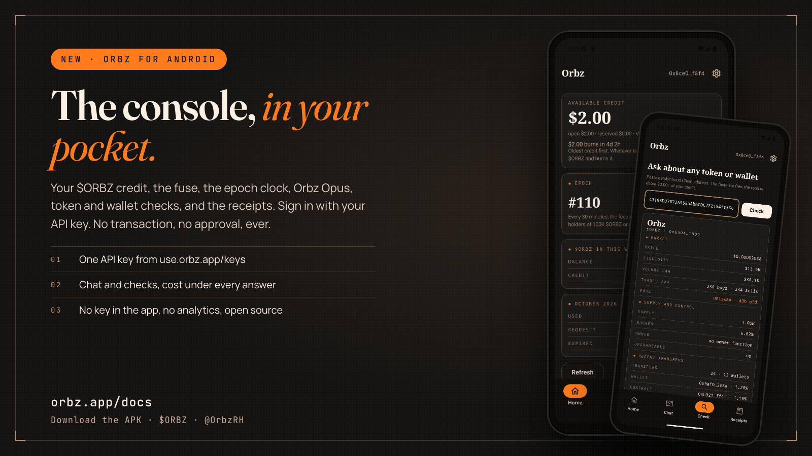
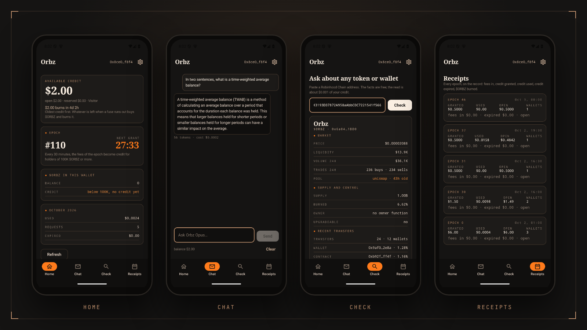
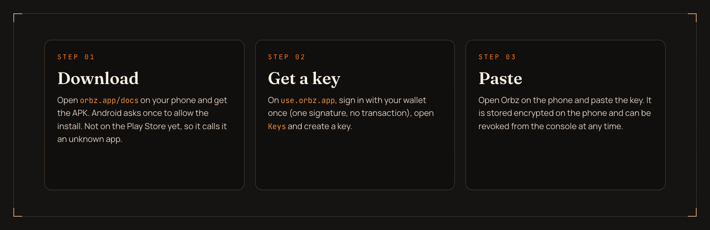

<p align="center">
  
</p>

<h1 align="center">Orbz for Android</h1>

[](releases/)
[](#install)
[](#build-from-source)

**[Download the APK](releases/orbz-android-0.1.0.apk)** · [Docs](https://orbz.app/docs#android) · [orbz.app](https://orbz.app) · [X @OrbzRH](https://x.com/OrbzRH)

---

## What it is

**Orbz for Android** is the Orbz console in your pocket. Hold $ORBZ, and the trading fees of the token become AI
credit for you every 30 minutes; this app shows that credit, spends it on Orbz Opus, and reads any token or
wallet on Robinhood Chain for you.

| | |
|---|---|
| **Home** | Available credit, the fuse on your oldest credit, the epoch clock with the next grant, your $ORBZ balance and whether it gets credit, this month's usage |
| **Chat** | Orbz Opus, streamed, with tokens and cost under every answer. Same meter and daily limit as the console's chat |
| **Check** | Paste a contract address or a wallet. Facts from the chain and DEX Screener, then Orbz Opus's read, then follow-ups. Facts only, never a buy or sell call |
| **Receipts** | Every epoch on the record: fees in, credit granted, used, expired, $ORBZ burned |

<p align="center"></p>

## Sign in

**0.1.0 signs in with an API key.** Sign in at [use.orbz.app](https://use.orbz.app) with your wallet once (one
signature, no transaction), open **Keys**, create a key and paste it into the app. The key is stored encrypted
with a key that lives in the Android Keystore, the app opts out of cloud backup, and you can revoke it from the
console at any moment.

**Connecting a wallet from the app** (WalletConnect, the same one-signature sign-in as the web) is built in and
arrives in the next release. The app asks a wallet for exactly one method, `personal_sign`. It never sends a
transaction and never asks for a token approval. If a prompt ever asks you for either, decline it: it is not
from Orbz.

## Install

<p align="center"></p>

1. **Download** [`orbz-android-0.1.0.apk`](releases/orbz-android-0.1.0.apk) on your phone (also at [orbz.app/docs](https://orbz.app/docs#android)).
2. **Open it.** Android asks once to allow installs from your browser or file manager; allow it. The app is not on
   the Play Store yet, so Android calls it an "unknown app": that is about the store, not the app.
3. **Paste your API key** from [use.orbz.app/keys](https://use.orbz.app/keys) and sign in.

Android 8.0 or newer. To update, install the new APK over the old one: your session stays.

### Verify the download

Every release lists the APK's SHA-256 in its notes. On your computer:

```
shasum -a 256 orbz-android-0.1.0.apk
```

The APK is signed with the same key every release, so Android refuses an update that does not match.

## Privacy

- The app talks to `use.orbz.app` (the console) and to nothing else (plus the WalletConnect relay once wallet sign-in ships).
- Your wallet's key never leaves your wallet. The app holds an Orbz API key or a session cookie, encrypted, and nothing more.
- No analytics, no crash reporting, no accounts. The source is here.

## Files

| Path | What it is |
|---|---|
| `app/src/main/kotlin/app/orbz/android/auth/` | The sign-in message (`Siwe.kt`), the signer interface |
| `app/src/main/kotlin/app/orbz/android/wallet/Wc.kt` | WalletConnect through Reown AppKit: one chain, one method |
| `app/src/main/kotlin/app/orbz/android/net/` | The console's API and its streamed answers |
| `app/src/main/kotlin/app/orbz/android/store/SecureStore.kt` | The Keystore-encrypted session |
| `app/src/main/kotlin/app/orbz/android/ui/` | The screens, in Jetpack Compose |
| `app/src/debug/` | A local signer for emulator runs. Not in release builds |
| `app/src/test/`, `app/src/androidTest/` | Unit tests, and the whole flow on an emulator |

## Build from source

```
cp local.properties.example local.properties   # SDK path, WalletConnect project id, optional signing
./gradlew :app:assembleRelease
```

JDK 17, Android SDK 37. The WalletConnect project id is a public site key from [dashboard.reown.com](https://dashboard.reown.com);
without one, a build still runs but cannot connect wallets. Release signing settings are read from
`local.properties` or the environment and never from the tree.

Run the tests: `./gradlew :app:testDebugUnitTest`, and with an emulator and a local console,
`./gradlew :app:connectedDebugAndroidTest -Porbz.testPk=0x…`.

## Links

[orbz.app](https://orbz.app) · [Console](https://use.orbz.app) · [Docs](https://orbz.app/docs) · [Chrome extension](https://github.com/OrbzRH/orbz-extension) · [Widget](https://github.com/OrbzRH/orbz-widget) · [@OrbzRH](https://x.com/OrbzRH)
